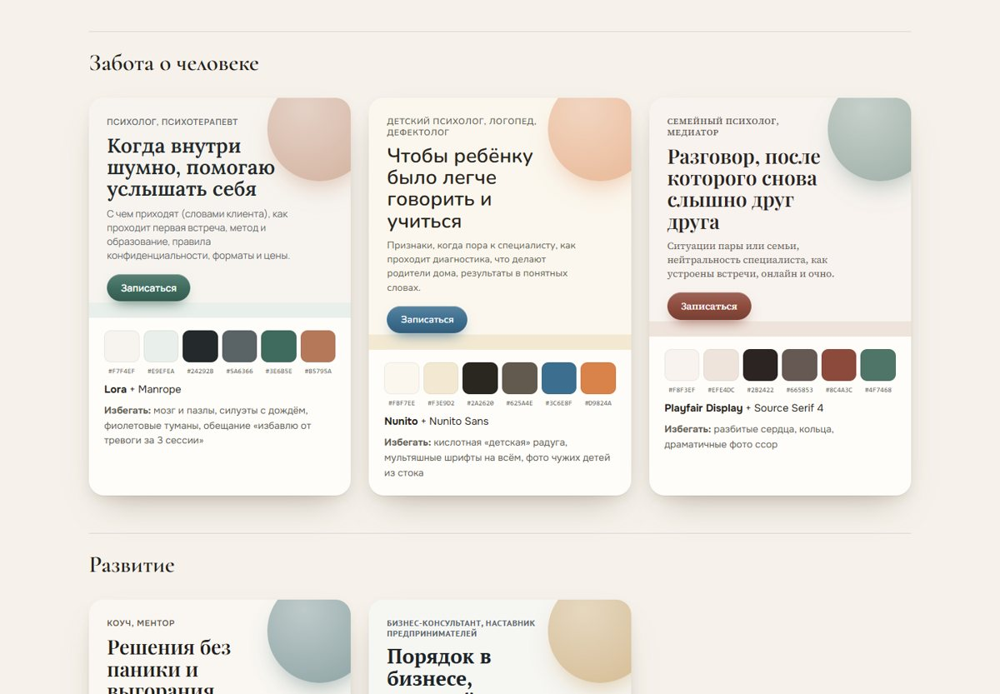
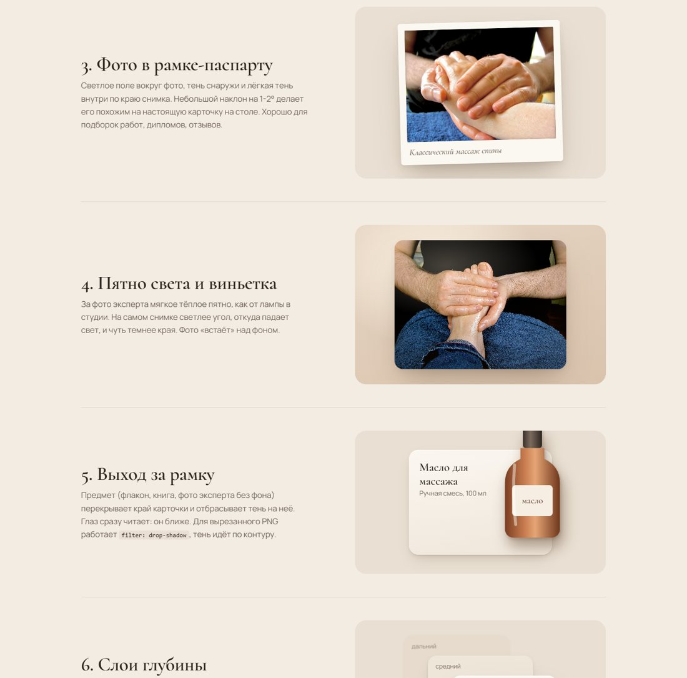

# Сайт эксперта

### Скилл для Claude Code и Codex: сайты и лендинги экспертов, которые продают доверие к человеку

Психолог, коуч, мастер, врач, юрист, онлайн-школа, автор. Скилл ведёт ИИ-агента от портрета эксперта к готовой странице: живой человек вместо стоковых картинок, понятное обещание, реалистичный объём, тексты, которые звучат по-человечески, и проверка результата перед показом.



[English below](#english)

## Что вы получаете

- **Порядок работы как у дизайн-студии.** Сначала портрет человека и одна главная мысль сайта, потом бриф, композиция, цвет, фото, тексты и проверка. Агент не выдумывает фактов: нет факта, нет его на сайте.
- **База 28 ниш.** Для каждой профессии стартовая палитра с проверенным контрастом, пара шрифтов с кириллицей, что показать на фото, какие блоки нужны, какие сомнения клиента закрыть и чего избегать. Живая галерея в `assets/nishi.html`.
- **Композиция на золотом сечении.** Колонки 38/62, шкала отступов 8-13-21-34-55-89, явные цветные блоки и плотная, журнальная подача.
- **Реализм и объём без тяжёлого 3D.** Девять приёмов: тени из трёх слоёв, рамки-паспарту, пятно света, выход предмета за рамку, слои глубины, цвет как глубина. Каждый с готовым CSS и живым демо.
- **Тексты с глубиной.** История эксперта, польза списками по аудиториям, личные истории с выводом, честные ответы на сомнения. Вычитка от ИИ-штампов для русского и английского.
- **Фото, видео и эффекты.** Как снимать и генерировать реалистичные сцены, как встроить видео без потери скорости, какие эффекты брать, а какие нет.
- **Живые образцы.** К каждому приёму ссылка на сайт, где он сделан хорошо: «портрет выходит за рамку → смотри здесь».
- **Две проверки.** Быстрая проверка файлов (Python, без установки) и проверка в настоящем браузере на четырёх ширинах экрана со скриншотами (Node.js и Playwright, по желанию).



## Установка

**Claude Code**

```bash
git clone https://github.com/eabelozer26-droid/expert-site-skill.git
cp -r expert-site-skill/skills/sait-eksperta ~/.claude/skills/
```

На Windows папка `%USERPROFILE%\.claude\skills\`. Репозиторий также подключается как плагин: `.claude-plugin/plugin.json`.

**Codex.** Скопируйте `skills/sait-eksperta` в `~/.codex/skills/` (или `~/.agents/skills/`) и перезапустите Codex. Манифест: `.codex-plugin/plugin.json`.

**Другие агенты.** Дайте агенту прочитать `skills/sait-eksperta/SKILL.md` перед задачей.

## Как пользоваться

Попросите агента обычными словами: «сделай сайт для психолога», «лендинг для онлайн-школы», «переделай мой сайт красиво». Скилл включится сам. Лучший результат будет, если дать материалы: текущий сайт, посты, рассказ о себе, свои фото и работы.

Проверка готового сайта:

```bash
# быстрая проверка файлов, без установки
python -I skills/sait-eksperta/scripts/proverka_saita.py путь/к/сайту

# проверка в браузере (нужны Node.js и playwright)
npm i -D playwright
node skills/sait-eksperta/scripts/proverka_v_brauzere.mjs путь/к/index.html
```

## Из чего состоит

| Файл | Что в нём |
|---|---|
| `SKILL.md` | порядок работы и главные правила |
| `references/nishi.md` | база 28 ниш |
| `references/kompozitsiya.md` | сетки, золотое сечение, плотность |
| `references/shrifty.md` | пары шрифтов с кириллицей, объёмный текст |
| `references/tsvet.md` | палитры, цвет как глубина, контраст |
| `references/foto-i-kartinki.md` | фото, генерация сцен, обработка, форматы |
| `references/obem-svet-ten.md` | 9 приёмов объёма с готовым CSS |
| `references/effekty.md` | какие эффекты брать, какие нет |
| `references/video.md` | видео на сайте и монтаж роликов |
| `references/teksty.md` | тексты, глубина, вычитка |
| `references/obrazcy.md` | живые образцы к каждому приёму |
| `references/proverka.md` | чек-лист перед показом |
| `assets/nishi.html` | галерея всех ниш |
| `assets/obem-demo.html` | демо приёмов объёма |
| `scripts/proverka_saita.py` | проверка файлов сайта |
| `scripts/proverka_v_brauzere.mjs` | проверка в браузере |

Все файлы лежат в папке `skills/sait-eksperta/`.

## Права и безопасность

- Скилл состоит из текстовых инструкций и двух скриптов проверки.
- `proverka_saita.py` только читает файлы сайта: стандартная библиотека Python, без сети.
- `proverka_v_brauzere.mjs` запускает браузер через Playwright, открывает только указанную страницу и сохраняет скриншоты рядом с ней. Ничего не скачивает сам.
- Нет хуков, MCP-серверов, ключей и переменных окружения.

## Лицензия

MIT (см. `LICENSE`). Две фотографии в `assets/img` и скриншот `docs/obem.jpg`: Wikimedia Commons, автор Lubyanka, CC BY-SA 3.0 (см. `NOTICE.md`).

Нашли ошибку или хотите добавить нишу? Открывайте issue. Если скилл пригодился, поставьте звезду: так его найдут другие.

---

## English

**Expert Website, a skill for Claude Code and Codex.** It guides an AI agent from a portrait of the expert to a finished landing page: a real person instead of stock imagery, a clear promise, realistic depth through photos, frames, light, shadow and colour, copy that sounds human, and a check before handoff.

Includes a base of 28 expert niches (contrast-checked palettes, Cyrillic-ready font pairs, what to photograph, which sections to include, client doubts to address, what to avoid), a golden-ratio layout system, nine depth techniques with ready CSS, guidance on photos, video and lightweight motion, live examples for each technique, a file checker (Python standard library, no network) and an optional real-browser checker (Playwright, four viewport widths, screenshots). Instructions are in Russian; models follow them in any language.

Install: copy `skills/sait-eksperta` into `~/.claude/skills/` (Claude Code) or `~/.codex/skills/` (Codex). License: MIT; two photos CC BY-SA 3.0 by Lubyanka (Wikimedia Commons).
